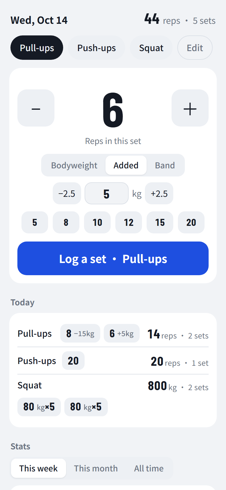

# Workout Log (運動紀錄)

**English** | [繁體中文](README.zh-TW.md)

A simple mobile web app for logging pull-ups, push-ups and other bodyweight reps — with added weight,
resistance-band assistance, and strength-training lifts like squats and bench press (weight and total volume).
No account, no server: your data stays on your phone, and it works offline.

👉 https://cyril1018.github.io/workout-log/



## Getting started

Open the link above on your phone and **add it to your home screen** so it opens like an app:

- **iPhone**: open in Safari → Share → "Add to Home Screen"
- **Android**: open in Chrome → menu (⋮) → "Add to Home screen"

From the home screen it opens full screen with no address bar, under a monkey-doing-a-pull-up icon.
On iPhone this is strongly recommended — see "Known limitations" below.

## Where your data lives

Your log is stored **only in this phone's browser** (localStorage) and is never uploaded anywhere.
Before clearing browser data or switching phones, use "Export backup" at the bottom of the page;
"Import backup" restores it.

## Features

- **Log a set**: pick an exercise, set the reps, tap the log button
- **Load**: bodyweight, added weight or resistance band (assistance); each exercise remembers the last one used
- **kg or lb**: US phones start in pounds, everyone else in kilograms; switch at the bottom of the page.
  Each set keeps the number and unit it was entered in, so nothing drifts; totals and charts convert to the unit shown.
- **Strength training**: mark an exercise as a "weight" type in the exercise editor and you only enter the weight
  (with ±2.5 kg or ±5 lb buttons). Sets show as `60kg×5`, and stats and the chart switch to training volume
  (weight × reps) and heaviest set. Added weight on bodyweight exercises doesn't count towards volume.
- **Edit / delete**: tap any set (today's or past) to change reps, weight, date and time, or delete it.
  Forgot to log a set? Log it now, then change the date.
- **Rename**: rename an exercise in the editor and all its past sets and stats follow
- **Stats**: totals for this week / month / all time (volume for weight types), sets, days, and a 14-day bar chart
- **Works offline**: after the first visit it opens and logs without a connection
- **Backup**: export / import a JSON backup, or export CSV for a spreadsheet
- **English and Traditional Chinese**: follows the phone's language; switch at the bottom of the page.
  Your exercise names are yours and are never translated.

## Known limitations

- **iPhone Safari may clear the data after 7 days without a visit** — a Safari privacy rule.
  It doesn't apply when the app is opened from the home screen.
- **No sync between devices**: phone and computer keep separate logs; move data with export / import.
- **Clearing browser data or using private browsing** loses the log or doesn't save it.

## Files

| File | Purpose |
|---|---|
| `index.html` | Page structure |
| `style.css` | Styles (including dark mode) |
| `app.js` | App logic |
| `i18n.js` | Interface text in English and Chinese, and language detection |
| `sw.js` | Service worker: fetches the latest version on every open, falls back to the last one offline |
| `manifest.webmanifest`, `manifest.en.webmanifest` | Name, icons and display mode for "Add to Home Screen" (Chinese / English) |
| `icons/` | App icons (generated by `tools/make-icons.js` — don't edit by hand) |
| `tools/make-icons.js` | Builds the icon from the monkey face plus a bar, writes every PNG size: `node tools/make-icons.js` |
| `tools/monkey-face.svg` | Monkey face used in the icon (Noto Emoji, license in `tools/NOTO-EMOJI-LICENSE.txt`) |
| `tests/` | Playwright tests; `serve.js` is a local server for the tests |
| `docs/screenshot-en.png`, `docs/screenshot.png` | Screenshots for the READMEs (made-up data), taken by `node tools/make-screenshots.js` |
| `LICENSE` | MIT license |

No build step — these files run as-is on GitHub Pages.

## Development

Requires Node.js.

```sh
npm install
npx playwright install chromium   # first time only
npm test
```

The tests start a local server on `127.0.0.1:4173` and stop it when done.

## Releasing

Push to `main`; GitHub Pages updates within about a minute.

If you changed `app.js`, `i18n.js` or `style.css`, bump all three `?v=` numbers in `index.html` (e.g. `app.js?v=7` → `app.js?v=8`).
The app compares this number to detect a new version; without the bump, phones with the app open won't see the
"new version available" prompt.

## Credits

The monkey face in the icon is from Google's [Noto Emoji](https://github.com/googlefonts/noto-emoji)
(🐵 U+1F435), licensed under the SIL Open Font License 1.1.

## License

[MIT](LICENSE). The monkey face in the icon is separately licensed under the SIL Open Font License 1.1.
